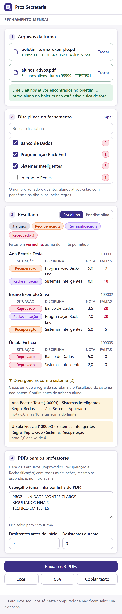

# Proz Secretaria

Extensão do Google Chrome com ferramentas para a secretaria escolar. O primeiro módulo, **Fechamento mensal**, lê o boletim da turma e a lista de alunos ativos (os dois em PDF, como saem do sistema acadêmico), aplica as regras de nota e frequência da secretaria e mostra quem ficou em **Recuperação**, **Reclassificação** ou **Reprovado** nas disciplinas escolhidas. O resultado pode ser exportado em Excel, CSV ou como texto pronto para colar no WhatsApp ou no e-mail.

<p align="center">
  <picture>
    <source media="(prefers-color-scheme: dark)" srcset="docs/img/painel-escuro.png" />
    
  </picture>
</p>

<sub>A imagem usa só dados fictícios, os mesmos dos testes automatizados.</sub>

---

## Sumário

- [Por que existe](#por-que-existe)
- [Privacidade](#privacidade)
- [Instalação](#instalação)
- [Como usar o Fechamento mensal](#como-usar-o-fechamento-mensal)
- [Arquivos de entrada](#arquivos-de-entrada)
- [Regras do fechamento](#regras-do-fechamento)
- [Conferências automáticas](#conferências-automáticas)
- [Exportações](#exportações)
- [Desenvolvimento](#desenvolvimento)
- [Arquitetura](#arquitetura)
- [Criando um módulo novo](#criando-um-módulo-novo)
- [Testes](#testes)
- [Próximos passos](#próximos-passos)

---

## Por que existe

Todo fim de mês a secretaria avisa os alunos ativos sobre a situação deles nas disciplinas que acabaram de fechar, normalmente uma ou duas por vez. Fazer isso à mão significa abrir o boletim da turma, procurar disciplina por disciplina, conferir nota, faltas e se o aluno ainda está ativo, e montar a lista. A extensão faz esse cruzamento em segundos e sem erro de digitação.

O projeto é uma extensão, e não um site, porque os próximos módulos vão interagir com páginas abertas no navegador. Por enquanto, o Fechamento mensal funciona inteiro dentro do painel lateral.

## Privacidade

Boletins têm dados pessoais de alunos, então a extensão foi feita para não expor nada:

- **Nada sai do computador.** Os PDFs são lidos no próprio navegador. A extensão não faz nenhuma requisição de rede e não tem permissão para acessar sites (`host_permissions` vazio).
- **Nada fica salvo.** Ao fechar o painel, os dados somem. A única coisa guardada (`chrome.storage.local`) é a preferência de visualização "por aluno / por disciplina".
- **Permissões mínimas:** `sidePanel` (painel lateral), `storage` (a preferência acima) e `clipboardWrite` (botão "Copiar texto").
- **O repositório não tem dados reais.** `*.pdf` e `*.xlsx` estão no `.gitignore`. Os testes e as imagens deste README usam alunos e turmas inventados (`tests/fixtures/builder.ts`).

## Instalação

A extensão ainda não está na Chrome Web Store.

### Pelo Release (mais simples)

1. Abra a página de [Releases](https://github.com/Durvaldo/proz-extention/releases) e baixe o `proz-secretaria-vX.Y.Z.zip` da versão mais recente.
2. Descompacte o arquivo numa pasta que não vai ser apagada (por exemplo, `Documentos\proz-secretaria`).
3. No Chrome, abra `chrome://extensions`, ligue o **Modo do desenvolvedor**, clique em **Carregar sem compactação** e escolha essa pasta.

Para atualizar: baixe o `.zip` novo, substitua o conteúdo da pasta e clique em ↻ (recarregar) no cartão da extensão.

### A partir do código

1. Instale o [Node.js](https://nodejs.org/) 20 ou mais recente.
2. Baixe o projeto e gere a extensão:
   ```bash
   npm install
   npm run build
   ```
   Isso cria a pasta `dist/`, que é a extensão pronta.
3. No Chrome, abra `chrome://extensions`.
4. Ligue o **Modo do desenvolvedor** (canto superior direito).
5. Clique em **Carregar sem compactação** e escolha a pasta `dist/`.
6. Fixe a extensão na barra (ícone de quebra-cabeça → alfinete). Clique no ícone para abrir o painel lateral.

**Para atualizar:** baixe a versão nova, rode `npm run build` de novo e clique em ↻ (recarregar) no cartão da extensão em `chrome://extensions`.

Requer Chrome 116 ou mais recente.

## Como usar o Fechamento mensal

### 1. Arquivos da turma

Baixe do sistema acadêmico os dois PDFs da turma e solte os dois juntos em qualquer uma das áreas (ou clique para escolher). A extensão reconhece cada PDF pelo conteúdo, então não importa o nome do arquivo nem a área onde foi solto.

| Área | Arquivo |
|---|---|
| **Boletim da turma** | Boletim escolar da turma em **PDF** (uma página por aluno) |
| **Alunos ativos** | Relação de alunos ativos da turma em **PDF** |

Depois de ler, cada arquivo mostra um resumo (por exemplo "Turma TABC123XYZ · 40 alunos · 17 disciplinas"), e uma mensagem verde confirma quantos alunos ativos foram encontrados no boletim.

### 2. Disciplinas do fechamento

A lista vem das disciplinas que existem no boletim, na ordem da grade. O número ao lado de cada disciplina é **quantos alunos ativos estão com pendência nela pelas regras**, então você já vê onde tem gente antes de marcar. Use a busca para achar uma disciplina rápido e **Limpar** para desmarcar todas.

### 3. Resultado

O resultado atualiza na hora, a cada disciplina marcada.

- **Por aluno:** cada aluno com todas as pendências dele nas disciplinas marcadas. É o formato para avisar o aluno.
- **Por disciplina:** cada disciplina com a lista de alunos. É o formato para conversar com o professor.
- **Etiquetas de situação:** clique em *Recuperação*, *Reclassificação* ou *Reprovado* para esconder ou mostrar aquela situação. O Excel, o CSV e o texto seguem o que está na tela; os PDFs dos professores trazem sempre as três.

Cada linha mostra a nota final e as faltas (ex.: `nota 7,0 · 20 faltas acima do limite`).

No fim do resultado, **Divergências com o sistema** (fechado por padrão) lista os casos em que a situação calculada pelas regras é diferente do *Resultado* que o sistema escreveu no boletim, com o motivo, para quem quiser conferir.

### 4. PDFs para os professores

O botão **Baixar os 3 PDFs** gera, de uma vez, os arquivos que vão para os professores, no layout dos modelos da secretaria (logo, cabeçalho, título em roxo, um bloco por aluno e o relatório de totais):

| Arquivo | Conteúdo |
|---|---|
| `REPROVADOS - <turma>.pdf` | "Disciplina – Reprovado por notas e faltas" (nota abaixo de 6 com faltas acima do limite) ou "– Reprovado por notas"; totais de reprovados por notas e faltas, por notas e de desistentes |
| `RECUPERAÇÃO - <turma>.pdf` | "Disciplina – Reprovado por notas"; total de alunos em recuperação |
| `RECLASSIFICAÇÃO - <turma>.pdf` | "Disciplina – Reprovado por faltas"; total de alunos em reclassificação |

- Os PDFs trazem sempre as três situações, mesmo as escondidas pelas etiquetas da tela.
- **Cabeçalho:** uma linha do PDF por linha do campo. Vem preenchido com a unidade, "RESULTADOS FINAIS" e o curso do boletim; o que você editar fica salvo para a turma.
- **Desistentes** (antes do início e durante o módulo) não estão no boletim: preencha os números, que saem no relatório de reprovados.
- Os totais contam alunos, não disciplinas: quem foi reprovado por notas e faltas numa disciplina e só por notas em outra conta nos dois totais, como nos modelos.

### 5. Outras exportações

| Botão | O que gera |
|---|---|
| **Excel** | `fechamento_<turma>_<data>.xlsx` com as abas *Fechamento* (uma linha por pendência, com filtro), *Divergências* e *Resumo* (regras usadas e totais) |
| **CSV** | `fechamento_<turma>_<data>.csv` separado por `;`, com vírgula decimal, que abre direto no Excel em português |
| **Copiar texto** | Texto agrupado por aluno, para colar no WhatsApp ou no e-mail |

## Arquivos de entrada

### Boletim da turma (PDF)

É o boletim escolar exportado pelo sistema acadêmico: uma página por aluno, seguida do canhoto. De cada página a extensão lê:

- **Nome** e **Matrícula** do aluno (cabeçalho `Nome · Matrícula · Curso`);
- **Turma** (cabeçalho `Unidade/Polo · Turma · Ano/Semestre · Módulo/Série`);
- uma linha por disciplina com `Avaliações presenciais · Atividades online · Recuperação · Reclassificação · Nota parcial · Nota final · Faltas · Resultado`.

Exemplo fictício de uma linha, como a extensão a enxerga:

```
Programação Back-End    7,00   0,00   0,0   0,0   7,0   7,0   *20   Reclassificação
```

O asterisco nas **faltas** é a marca do próprio sistema para "acima do percentual permitido" (está no rodapé do boletim). Asterisco na **nota** marca nota abaixo da média e é ignorado na leitura.

O texto é extraído com o [pdf.js](https://mozilla.github.io/pdf.js/) e as linhas são remontadas pela posição na página. No PDF do sistema, o nome da disciplina fica na mesma altura das notas, então cada linha sai completa. Se outro PDF trouxer os nomes separados das notas, a extensão casa os dois pela ordem.

### Alunos ativos (PDF)

É a relação de alunos da turma. Cada aluno aparece com a matrícula entre colchetes:

```
12345 - TABC123XYZ / 01/02/2025 - 01/02/2027
Ana Beatriz Teste [100001]        (XX) Polo Exemplo
Bruno Exemplo Silva [100002]      (XX) Polo Exemplo
                                              Total de 2 alunos
```

Também são lidos o código da turma e o "Total de N alunos", usados nas conferências.

## Regras do fechamento

A situação de cada aluno é **calculada pela extensão** a partir da nota final e das faltas. O *Resultado* escrito no boletim não decide nada: ele só é usado para apontar divergências.

| Nota final | Faltas acima do limite (`*`)? | Situação |
|---|---|---|
| 6 ou mais | não | Aprovado |
| 6 ou mais | **sim** | **Reclassificação** |
| de 4 a menos de 6 | não | **Recuperação** |
| de 4 a menos de 6 | **sim** | **Reprovado** |
| menos de 4 | qualquer | **Reprovado** |

Provas que o aluno já fez (nota maior que zero na coluna correspondente do boletim):

- **Recuperação já feita** e nota final abaixo de 6 → **Reprovado** (não há outra recuperação).
- **Reclassificação já feita** → as faltas já foram tratadas; vale só a nota final.

Além disso:

- *Resultado* **Em Fechamento** (a disciplina terminou e o sistema ainda não deu o resultado) passa pelas regras normalmente; é justamente o caso do fechamento. Como o sistema ainda não decidiu, não conta como divergência.
- *Resultado* **Cursando** (a disciplina ainda não terminou para o aluno) fica fora das regras, com aviso.
- Só entram alunos que estão **na lista de ativos**, cruzados **pela matrícula**, e só as **disciplinas marcadas**.
- O resultado é ordenado por nome do aluno (ordem alfabética em português) e, dentro de cada aluno, pela ordem da grade.

### Divergências com o sistema

Toda linha (aluno ativo × disciplina marcada) em que a situação calculada é diferente do *Resultado* do sistema vira uma divergência, nos dois sentidos. O caso mais comum é **nota abaixo de 4**: a regra da secretaria diz Reprovado, e o sistema costuma marcar Recuperação. As divergências não somem com os filtros de situação e vão para a aba *Divergências* do Excel.

## Conferências automáticas

| Situação | O que acontece |
|---|---|
| Boletim e lista de ativos de **turmas diferentes** | Erro em vermelho; o fechamento fica bloqueado |
| Nenhum aluno ativo aparece no boletim | Erro em vermelho; o fechamento fica bloqueado |
| Aluno ativo que **não está no boletim** | Aviso em amarelo com o nome e a matrícula |
| "Total de N alunos" do PDF diferente do que foi lido | Aviso em amarelo |
| Aluno com menos disciplinas que os outros no boletim | Aviso em amarelo (PDF possivelmente incompleto) |
| PDF que não é boletim nem lista de ativos | Erro explicando o que se espera |
| Arquivo que não é PDF ou com mais de 20 MB | Erro |

## Exportações

Exemplo do **Copiar texto** (dados fictícios):

```
Fechamento – Turma TABC123XYZ – 12/11/2026
Disciplinas: Banco de Dados, Sistemas Inteligentes

Bruno Exemplo Silva (100002)
• Banco de Dados: Reprovado (nota 3,5, 20 faltas)
• Sistemas Inteligentes: Recuperação (nota 5,0, 5 faltas)

Total: 1 aluno(s) – 1 em Recuperação, 1 em Reprovado.
```

**Excel**: a aba *Fechamento* tem as colunas `Aluno | Matrícula | Disciplina | Situação | Nota final | Faltas | Faltas acima do limite | Resultado no sistema | Confere com o sistema`, com filtro automático. A aba *Divergências* lista regra × sistema com o motivo, e a aba *Resumo* traz a turma, a data, as disciplinas, os totais por situação e as regras aplicadas.

**CSV**: tem as mesmas colunas da aba *Fechamento*, em UTF-8 com BOM, para os acentos aparecerem certos no Excel.

## Desenvolvimento

| Comando | O que faz |
|---|---|
| `npm run build` | Gera a extensão em `dist/` |
| `npm test` | Testes unitários (Vitest) |
| `npm run test:e2e` | Build + testes com a extensão carregada num Chromium (Playwright) |
| `npm run typecheck` | Verificação de tipos (TypeScript) |
| `npm run lint` | ESLint |
| `node scripts/gerar-icones.mjs` | Regera os ícones PNG a partir do SVG do script |
| `CAPTURA=1 npx playwright test captura` | Regera as imagens do README (rode `npm run build` antes) |

Na primeira vez, os testes E2E precisam do Chromium do Playwright: `npx playwright install chromium`.

**Stack:** TypeScript, esbuild, Manifest V3 (side panel), [pdf.js](https://mozilla.github.io/pdf.js/) para ler os PDFs, [SheetJS](https://sheetjs.com/) para gerar o Excel, Vitest e Playwright. Não há framework de interface: o painel é HTML + CSS + TypeScript puro.

## Arquitetura

```
manifest.json            Manifest V3: side panel, sem acesso a sites
scripts/
  build.mjs              esbuild → dist/ (copia HTML, CSS, ícones e o worker do pdf.js)
  gerar-icones.mjs       SVG → PNG 16/32/48/128
src/
  background/index.ts    abre o painel ao clicar no ícone
  panel/                 casca do painel: tema, barra superior, abas de módulos
    index.html
    panel.css            tokens de cor (claro/escuro) e componentes
    panel.ts             registro de módulos
  core/                  lógica pura, sem DOM, coberta por testes unitários
    types.ts             Registro, Boletim, ListaAtivos, Aviso, Leitura<T>
    normalizar.ts        acentos, números com vírgula, formatação
    pdf-linhas.ts        pedaços de texto do PDF (com posição) → linhas e colunas
    boletim.ts           texto do boletim em PDF → Boletim
    ativos.ts            texto da lista de ativos em PDF → ListaAtivos
    regras.ts            nota × faltas × provas feitas → situação
    fechamento.ts        conferência, regras por aluno, divergências com o sistema
    exportar.ts          xlsx, csv e texto
    relatorios.ts        conteúdo dos 3 PDFs dos professores (textos e totais)
    relatorio-pdf.ts     desenho desses PDFs com pdf-lib (layout dos modelos)
  modules/
    fechamento/
      view.ts            tela do módulo (estado, eventos, renderização)
      pdf.ts             extração de texto com pdf.js (no navegador)
tests/
  fixtures/builder.ts    boletim e lista de ativos fictícios (texto e HTML para imprimir em PDF)
  unit/                  testes do core
  e2e/                   extensão real no Chromium
docs/
  decisoes.md            registro das decisões de projeto
  img/                   imagens do README
```

**Fluxo de dados do Fechamento mensal:**

```
boletim.pdf ─┐                 ┌─ boletim.ts ─┐
             ├─ pdf.ts ─ pdf-linhas.ts ─┤              ├─ fechamento.ts + regras.ts ─┬─ view.ts (tela)
ativos.pdf ──┘                 └─ ativos.ts ──┘                               └─ exportar.ts (xlsx/csv/texto)
```

Toda leitura devolve um `Leitura<T>` (`{ ok: true, valor, avisos }` ou `{ ok: false, erro }`), com mensagens em português prontas para mostrar na tela.

## Criando um módulo novo

1. Crie `src/modules/<nome>/view.ts` exportando `iniciar<Nome>(raiz: HTMLElement)`.
2. Em `src/panel/index.html`, adicione `<div data-modulo="<nome>" class="modulo">…</div>` com a marcação do módulo.
3. Em `src/panel/panel.ts`, adicione a entrada em `MODULOS`:
   ```ts
   { id: '<nome>', titulo: 'Título na aba', iniciar: iniciar<Nome> }
   ```
4. Com dois ou mais módulos, as abas aparecem sozinhas no topo do painel.

Coloque a lógica que não depende da tela em `src/core/`, com testes em `tests/unit/`. Se o módulo precisar acessar um site, adicione só aquele domínio em `host_permissions` e registre o motivo em `docs/decisoes.md`.

## Testes

- **Unitários** (`tests/unit/`): tabela de regras (incluindo os limites exatos de nota e as provas já feitas), montagem de linhas a partir das posições do PDF, leitura do boletim (canhoto repetido, nomes de disciplina separados das notas, asterisco nas faltas), leitura da lista de ativos, conferências e as três exportações.
- **Ponta a ponta** (`tests/e2e/extension.spec.ts`): carrega a extensão num Chromium, imprime os dois PDFs fictícios, solta os dois juntos e verifica disciplinas, resultado, divergências, filtros, downloads e cópia, além dos bloqueios por turma diferente e arquivo errado.

Nenhum teste usa dados reais. Para conferir com arquivos de verdade, carregue a extensão no Chrome e use os PDFs localmente; não os adicione ao repositório.

## Versões

As versões seguem o [Versionamento Semântico](https://semver.org/lang/pt-BR/) (`MAIOR.MENOR.CORREÇÃO`):

- **CORREÇÃO** (`1.0.1`): correção de erro ou ajuste visual;
- **MENOR** (`1.1.0`): função nova, sem mudar o jeito de usar;
- **MAIOR** (`2.0.0`): muda o jeito de usar ou os arquivos de entrada.

A versão fica no `package.json` e no `manifest.json` (é a que o Chrome mostra) e as duas andam sempre juntas. Cada versão publicada tem uma tag `vX.Y.Z` e um [Release](https://github.com/Durvaldo/proz-extention/releases) no GitHub, com as novidades e a extensão pronta em `.zip`.

Para publicar uma versão nova (com o [GitHub CLI](https://cli.github.com/)):

```bash
# 1. Atualize "version" no package.json e no manifest.json (ex.: 1.1.0)
npm test && npm run build
git commit -am "Versão 1.1.0"
git tag v1.1.0 && git push --follow-tags

# 2. Empacote o dist/ e crie o Release
#    (Windows: Compress-Archive -Path dist\* -DestinationPath proz-secretaria-v1.1.0.zip)
gh release create v1.1.0 proz-secretaria-v1.1.0.zip --title "v1.1.0" --notes "O que mudou nesta versão"
```

## Próximos passos

- Modelo de mensagem configurável para o "Copiar texto".
- Novos módulos da secretaria.
